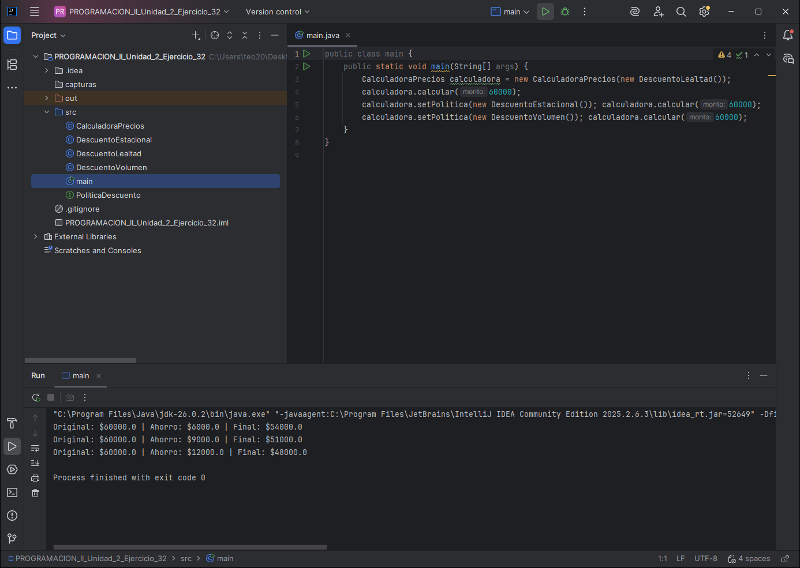

# PROGRAMACIÓN II — Unidad 2, Ejercicio 32: El Sistema de Gestión de Descuentos Comerciales

Trabajo práctico de Programación II. Este repositorio contiene la resolución en Java del ejercicio 32 de la Unidad 2.

## Consigna

#### Contexto

Una plataforma de comercio electrónico aplica diferentes políticas de descuento según la categoría del cliente o la temporada (descuento por lealtad, descuento estacional, descuento por volumen de compra). La modularidad permite aislar cada regla de cálculo fiscal y comercial en clases independientes para facilitar su mantenimiento.

#### Consigna

Modelar un sistema de cálculo de rebajas aplicando abstracción para que el módulo de facturación aplique distintas estrategias de descuento de forma transparente y desacoplada.

#### Desarrollo requerido

- Definir una interfaz o clase abstracta PoliticaDescuento que contenga el método abstracto double calcularDescuento(double montoOriginal).
- Crear clases concretas como DescuentoLealtad, DescuentoEstacional y DescuentoVolumen que implementen las reglas específicas de cálculo con sus respectivos porcentajes o topes.
- Diseñar la clase CalculadoraPrecios que reciba una política de descuento y procese el valor final a pagar.
- En el método main, instanciar diferentes políticas, aplicarlas a un monto de compra base y mostrar el desglose de los ahorros por consola.

## Estructura del repositorio

```
PROGRAMACION_II_Unidad_2_Ejercicio_32/
├── README.md
├── capturas/
│   └── consola.png
└── src/
    ├── CalculadoraPrecios.java
    ├── DescuentoEstacional.java
    ├── DescuentoLealtad.java
    ├── DescuentoVolumen.java
    ├── main.java   # clase con el método main
    └── PoliticaDescuento.java
```

## Funcionamiento y lógica

El ejercicio aplica el **patrón Estrategia** con una interfaz: la calculadora de precios puede cambiar su política de descuento sin modificar su código.

### `PoliticaDescuento` (interfaz)

Define `double calcularDescuento(double montoOriginal)`.

### Políticas de descuento

- **`DescuentoLealtad`:** 10 % sobre montos positivos.
- **`DescuentoEstacional`:** 15 % sobre montos positivos.
- **`DescuentoVolumen`:** 20 %, pero solo para compras de $50000 o más.

### `CalculadoraPrecios`

Guarda la política actual (que se puede cambiar con `setPolitica()`). Su método `calcular(monto)` le pide el descuento a la política y muestra el monto original, el ahorro y el precio final.

### `main`

Calcula el precio de una compra de $60000 con las tres políticas:

| Política | Ahorro | Final |
|---|---|---|
| Lealtad | $6000 | $54000 |
| Estacional | $9000 | $51000 |
| Volumen | $12000 | $48000 |

## Ejecución

Captura de la consola de IntelliJ IDEA ejecutando el programa:



Salida obtenida:

```
Original: $60000.0 | Ahorro: $6000.0 | Final: $54000.0
Original: $60000.0 | Ahorro: $9000.0 | Final: $51000.0
Original: $60000.0 | Ahorro: $12000.0 | Final: $48000.0
```
